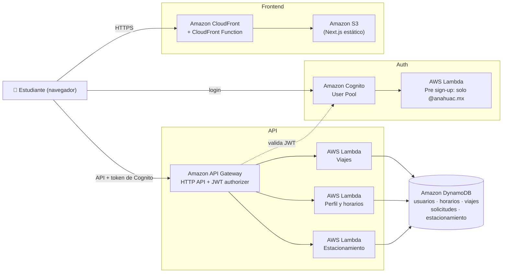

# Aventón Mayab

App para estudiantes de la Anáhuac Mayab: aventones entre compañeros y disponibilidad del estacionamiento. Proyecto del equipo **AWSome team** (equipo 2) para el hackathon de AWS.

**App:** https://d1ivrhj0shesvg.cloudfront.net

## El problema

La mayoría de los estudiantes de la Anáhuac Mayab llega en coche, casi siempre una persona por coche. En las horas pico el estacionamiento se llena, se pierde tiempo buscando lugar y se llega tarde a clase. Quien no tiene coche depende de que alguien conocido vaya a la misma hora, y hoy no hay una forma segura de encontrar compañeros de la misma universidad que salgan de su misma zona.

## La solución

Una app web para el celular, solo para la comunidad Anáhuac:

- **Login con correo `@anahuac.mx`:** nadie de fuera puede registrarse.
- **Aventones:** un conductor publica de qué colonia sale, a qué hora y cuántos lugares tiene; otros estudiantes piden lugar y el conductor acepta o rechaza. No se puede aceptar a más pasajeros que lugares (lo garantiza una transacción en DynamoDB).
- **Privacidad:** antes de aceptar solo se ve el primer nombre del conductor; el teléfono y el punto de encuentro se comparten únicamente con pasajeros aceptados y mientras el viaje está activo. Nunca se comparte el domicilio.
- **Horario de clases:** cada estudiante arma su horario en una cuadrícula. Es privado y se usa para proyectar la ocupación y darle recomendaciones.
- **Estacionamiento:** disponibilidad por zona, para saber dónde hay lugar antes de llegar.

## Arquitectura



Versión en imagen: [`docs/arquitectura.png`](docs/arquitectura.png).

Toda la infraestructura se crea con AWS CloudFormation (plantillas en `backend/infra/` y AWS SAM en `backend/template.yaml`), y cada Lambda tiene un rol de IAM con permisos solo sobre sus tablas. El frontend nunca habla directo con la base de datos y no necesita llaves de AWS.

## Servicios de AWS usados

| Servicio | Para qué |
| --- | --- |
| **Amazon Cognito** | Registro e inicio de sesión. Un trigger rechaza correos que no sean `@anahuac.mx`. |
| **AWS Lambda** (Node.js 22, arm64) | La lógica: viajes, solicitudes, perfil, horarios, estacionamiento y el trigger de registro. |
| **Amazon API Gateway** (HTTP API) | Expone la API y valida el token de Cognito antes de llamar a las Lambdas. |
| **Amazon DynamoDB** | Base de datos (on-demand): usuarios, horarios, viajes, solicitudes y estacionamiento. |
| **Amazon S3** | Guarda el sitio estático del frontend (privado). |
| **Amazon CloudFront** | Sirve la app por HTTPS; solo CloudFront puede leer el bucket (Origin Access Control). |
| **AWS CloudFormation / AWS SAM** | Infraestructura como código para todo lo anterior. |
| **AWS IAM** | Roles con permisos mínimos para cada Lambda. |

El módulo opcional [`backend/smartparking/`](backend/smartparking/) usa además AWS CDK y Amazon CloudWatch Logs.

## Código y librerías preexistentes

No escribimos estas herramientas; las usamos tal cual:

- **Frontend:** [Next.js](https://nextjs.org) y React, Tailwind CSS, componentes de [shadcn/ui](https://ui.shadcn.com) (sobre Base UI), lucide-react (íconos), SWR, sonner, Recharts, cmdk, input-otp, next-themes, class-variance-authority, clsx, tailwind-merge, tw-animate-css, `@vercel/analytics` y AWS Amplify (login con Cognito).
- **Backend:** AWS SDK for JavaScript v3 (`@aws-sdk/client-dynamodb`, `@aws-sdk/lib-dynamodb`, `@aws-sdk/client-cognito-identity-provider`), esbuild, AWS SAM CLI y AWS CDK (Smart Parking).
- **Pruebas:** Python 3 (biblioteca estándar) para la prueba de integración y Playwright para pruebas en navegador.

## Cómo se ejecuta

**Usar la app:** abre https://d1ivrhj0shesvg.cloudfront.net en el celular y regístrate con un correo `@anahuac.mx`.

**Frontend en local** (Node.js 22 y pnpm):

```bash
cd frontend
pnpm install
pnpm dev        # http://localhost:3000, usa la API publicada
```

**Backend en AWS** (AWS CLI con credenciales y AWS SAM CLI):

```bash
# Una vez: Cognito, tablas y hosting (ver backend/README.md)
aws cloudformation deploy --region us-east-1 --template-file backend/infra/cognito.yaml --stack-name aventon-mayab-auth --capabilities CAPABILITY_IAM
aws cloudformation deploy --region us-east-1 --template-file backend/infra/dynamodb.yaml --stack-name aventon-mayab-data
aws cloudformation deploy --region us-east-1 --template-file backend/infra/frontend.yaml --stack-name aventon-mayab-frontend

# API Gateway + Lambdas
cd backend
sam build
sam deploy

# Prueba de integración contra AWS
python tests/integration_test.py
```

**Publicar el frontend en AWS:** `./frontend/deploy-aws.sh` (build estático, sube a S3 e invalida CloudFront).

## Estructura

```
├── frontend/              App web (Next.js estático en S3 + CloudFront; `deploy-aws.sh` la publica)
│   ├── app/               Páginas
│   ├── components/        Componentes de UI
│   ├── lib/services/      authService.ts (Cognito), api.ts (llamadas a la API) y servicios
│   └── .env.example       Valores públicos (Cognito, URL de la API) que se incluyen en el build
├── backend/               Todo lo de AWS
│   ├── infra/             Cognito, tablas de DynamoDB y hosting del frontend
│   ├── src/               Código de las Lambdas (Node.js 22)
│   ├── tests/             Prueba de integración contra AWS
│   ├── template.yaml      API Gateway + Lambdas
│   ├── samconfig.toml     Configuración de `sam deploy`
│   └── smartparking/      Módulo de Smart Parking (CDK, se despliega aparte)
└── docs/
    └── api.md             Rutas de la API para el frontend
```

- [`frontend/README.md`](frontend/README.md): cómo correr la app y publicarla en AWS.
- [`backend/README.md`](backend/README.md): cómo desplegar y probar.
- [`docs/api.md`](docs/api.md): la API.

## Backend de Smart Parking

El módulo está en [`backend/smartparking/`](backend/smartparking/). Incluye la API de zonas, entradas y salidas, infraestructura AWS CDK, pruebas y el contrato para el frontend TSX. Ejecuta sus comandos desde esa carpeta; consulta su [guía de desarrollo y despliegue](backend/smartparking/README.md).

Smart Parking requiere el **access token** de Cognito: el `authService.getToken()` actual devuelve un ID token, por lo que para este módulo se debe obtener `tokens.accessToken` mediante `fetchAuthSession()`, como muestra su README. El stack CDK crea tablas propias; todavía no reutiliza las tablas de parking del stack `aventon-mayab-data` (`backend/infra/dynamodb.yaml`).

## Avance

- [x] Paso 2: Login con Cognito (solo correos `@anahuac.mx`)
- [x] Paso 3: Tablas de DynamoDB
- [x] Paso 4: Lambdas con las reglas (sin sobreventa, sin doble entrada, privacidad, borrar cuenta)
- [x] Paso 5: API Gateway: `https://zdm8p9cfd7.execute-api.us-east-1.amazonaws.com`
- [ ] Paso 6: Sensores del estacionamiento con IoT Core
- [ ] Paso 7: Pronósticos
- [ ] Paso 8: Conectar el frontend: listo para login, perfil, horarios, viajes y solicitudes; falta estacionamiento
- [x] Frontend publicado en AWS (S3 + CloudFront): https://d1ivrhj0shesvg.cloudfront.net
